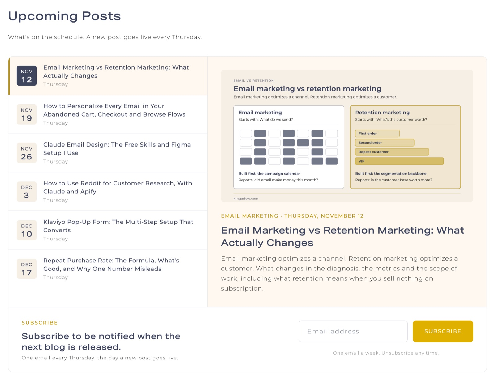
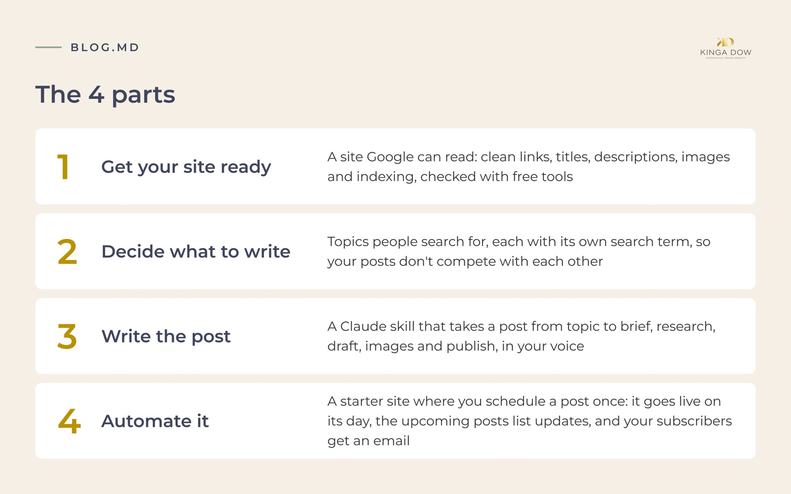

# BLOG.md

**A blog system you build yourself with Claude to share your expertise and create more visibility for yourself, so the people looking for it can find you and learn from it. Along the way you build authority and generate leads.**

You know things your future clients search for every day. The setup used to need a developer: a site Google can read, topics people search, a post every week, and the emails around it. Claude can do the technical part now, so you can build the whole system yourself. It has run every week on [kingadow.com](https://kingadow.com/blog) since July 30, 2026, and in the 13 weeks after weekly posts began, the blog was shown in Google 83% more often than in the 13 weeks before.

**[Download the kit (zip)](https://github.com/kingadow/blog-md/releases/latest/download/blog-md.zip)**, or clone the repo. Then pick your path: **No blog yet** or **You have a site**. Steps 1 and 3 are the same for both.

## Start here

1. **Write your `BLOG.md`.** Copy [`BLOG.md`](BLOG.md) and fill in sections 1 to 3: your site, who you write for and what you want readers to do. The rest can wait until your first post. Everything else reads it. It goes in the root of your site's folder: the top folder that holds your site's files. No site folder yet? Keep it anywhere for now and move it in at step 2. [The filled-in example](examples/kingadow-com/BLOG.md) shows a finished one.
2. **Get a site ready.**
   - **No blog yet:** run the [starter site](starter/README.md) on your computer. Open the kit's `starter` folder in Claude Code and say: *"Copy this folder to a new folder called my-blog in my Documents folder, not inside the kit. Then install and run the site there and give me the address to open."* Then move your `BLOG.md` into `my-blog`, next to `package.json`. From now on, open `my-blog` in Claude Code, not `starter`.
   - **You have a site:** clean it up with [part 1](docs/1-get-your-site-ready.md): connect Google Search Console and the free Ahrefs tools, run the audit, and ask Claude to fix what it finds.
3. **Write your first post.** Open your site's folder in Claude Code in a new session (on the starter path, `my-blog`): a skill in that folder only loads in a session opened on it. First install the [`blog-pipeline`](skills/blog-pipeline) skill. Ask Claude: *"Copy skills/blog-pipeline from the blog-md kit at [where you saved the kit] into my site's .claude/skills folder."* That folder sits inside your site's folder. Its name starts with a dot, so Finder and File Explorer hide it; Claude can still see it. To use the skill in every project, copy it to `~/.claude/skills/` instead, where `~` means your home folder. Then ask: *"Use the blog-pipeline skill to plan my first post."* Claude finds topic ideas (stage 1), you pick one, and it writes the brief (stage 2). [Part 3](docs/3-write-the-post.md) has the stages after that.
4. **Finish the setup.**
   - **No blog yet:** put the site online with the [starter's steps](starter/README.md) (GitHub and Netlify, both free). Once it's online, connect Search Console and Ahrefs Webmaster Tools with steps 1, 2 and 6 of [part 1](docs/1-get-your-site-ready.md).
   - **You have a site:** add the automation pieces from [part 4](docs/4-automate.md): the date gate, the upcoming posts list, the weekly build and the publish-day email.
   - **Your site is a Shopify store:** follow [part 4 on Shopify](docs/4-automate-shopify.md): Shopify's own scheduling, an upcoming posts section for your theme, and the publish-day email from your blog's feed.

[Part 2](docs/2-decide-what-to-write.md) explains how topics get picked, if you want to do it by hand or understand what the skill does.

## The 4 parts

| | Part | What you get |
|---|---|---|
| 1 | [Get your site ready for SEO](docs/1-get-your-site-ready.md) | A site Google can read: clean links, titles, descriptions, images and indexing, checked with free tools |
| 2 | [Decide what to write](docs/2-decide-what-to-write.md) | Topics people search for, each with its own search term, so your posts don't compete with each other |
| 3 | [Write the post](docs/3-write-the-post.md) | A Claude skill that takes a post from topic to brief, research, draft, images and publish, in your voice |
| 4 | [Automate it](docs/4-automate.md) | A starter site where you schedule a post once: it goes live on its day, the upcoming posts list updates, and your subscribers get an email |

Part 5, a weekly routine where Claude checks your Search Console numbers and makes small SEO fixes, comes in the next release.

## What's inside

| | What it is | Use it to |
|---|---|---|
| [`BLOG.md`](BLOG.md) | A template for your blog's rules: audience, voice, words to avoid, categories, cadence, SEO and image rules | Give Claude one file to read before it writes anything |
| [`docs/`](docs) | The 4 parts as step-by-step guides, each with prompts to give Claude | Follow along at your own pace |
| [`skills/blog-pipeline`](skills/blog-pipeline) | The writer: idea, brief, research, draft, visuals and publish, one folder per post | Write posts that answer what people search |
| [`starter/`](starter) | A small blog site: posts with a date stay hidden until that day, the upcoming posts list with a subscribe box, a weekly build and a publish-day email | Run your blog, or copy the pieces into your own site |
| [`examples/kingadow-com`](examples/kingadow-com) | The real example: the cleanup, the weekly rhythm and the results | See what it looks like on a live site |

## The upcoming posts list

The starter blog shows what's coming next: the next scheduled posts, each with a short description, and a subscribe box underneath. A post leaves the list on the day it goes live. Readers see what's planned, find something they want, and subscribe so they don't miss it.

You can see it working at [kingadow.com/blog](https://kingadow.com/blog).

## What you need

Every account and tool the 4 parts use, in one list. Claude does the technical work; you make the decisions.

| What | Cost | Used for |
|---|---|---|
| [Claude Code](https://claude.com/claude-code), or Claude with access to your files | Paid Claude plan | All 4 parts |
| [Node.js](https://nodejs.org) 20.3 or newer | Free | Running the starter site on your computer (part 4) |
| [GitHub](https://github.com) account | Free | Storing the site and running the weekly build (part 4) |
| [Netlify](https://www.netlify.com) account | Free plan | Putting the site online (part 4) |
| [Google Search Console](https://search.google.com/search-console) | Free | What people search when your site shows up, and indexing (parts 1, 2, 3) |
| [Ahrefs Webmaster Tools](https://ahrefs.com/webmaster-tools) | Free | The Site Audit (part 1) |
| [Ubersuggest](https://neilpatel.com/ubersuggest/) | Free plan, 3 reports a day | Search volume and difficulty (part 2). Use the website and paste the results into Claude; no connection needed. |
| Google Chrome | Free | Making the PNG copy of each featured image (part 3). Any browser works for everything else. |
| An email tool for subscribers | Optional | The subscribe box and the publish-day email (part 4). The starter is set up for Klaviyo, which has a free plan for small lists; the starter README says how to use another tool. |
| Your own domain name | Optional, paid | A custom address. Netlify gives you a free address to start. |
| A Shopify store | Paid Shopify plan | The Shopify path: your store's blog in place of the starter site ([part 4 on Shopify](docs/4-automate-shopify.md)) |
| A Shopify development store | Free, made in the Shopify Dev Dashboard (a Shopify Partner account opens it too) | Testing the Shopify path before your live store |
| [Apify](https://apify.com) | Optional, paid after the free monthly credit | Checking page one for many search terms at once (part 2). A private browser window does the same for a few terms. |

If you already have a site, you may not need Node.js, GitHub or Netlify: [part 4](docs/4-automate.md) shows which pieces to copy. A Shopify store needs GitHub for the publish-day email only.

## Where it fits

This repo is the system for being found: the site, the topics, the writing and the schedule. What you write about, and what you offer the people who find you, is your expertise. If you sell to e-commerce brands and want help with retention and email, you can find me at [kingadow.com](https://kingadow.com).

## License

- The templates, skills, starter site and scripts are [MIT](LICENSE).
- The example in [`examples/kingadow-com`](examples/kingadow-com) is [CC BY 4.0](LICENSE-content.md): use it with credit.

Made by Kinga Dow.
