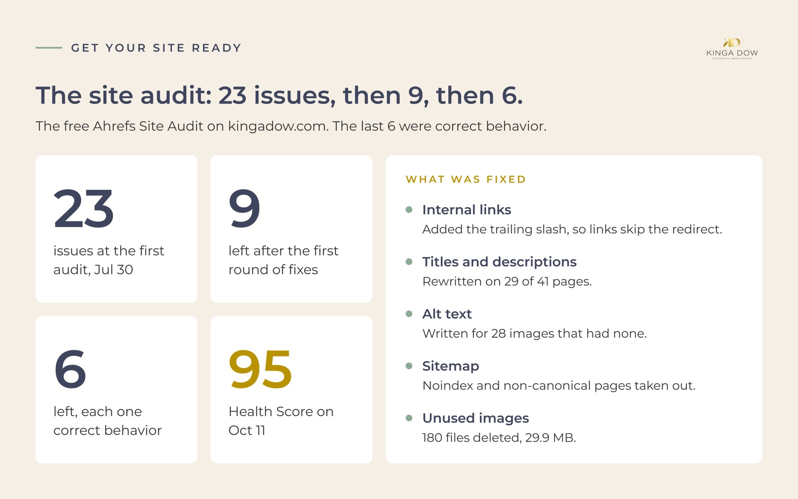

# Part 1: Get your site ready for search

**What you get:** a site Google can crawl and read cleanly, connected to 2 free tools that tell you
what to fix and whether your posts are indexed. New posts then land on a site that is ready for them.

**Do this first (about 15 minutes):** open [Google Search Console](https://search.google.com/search-console),
add your site and submit your sitemap. Step 1 below walks through it. Google needs a few days to
collect data, so starting today means you have numbers when you reach Part 2. No site online yet?
Run the [starter site](../starter/README.md) first and come back once it is online.

You do not need to write code. Claude Code (or Claude with access to your site's files) makes the
changes. Your job is to run the free tools, paste what they find into Claude, and check the result.
Every account this part uses is in [What you need](../README.md#what-you-need) in the README.

> **If you use the starter site**
>
> The [starter](../starter/README.md) already handles most of Step 4:
> - internal links with the trailing slash (4a)
> - a sitemap that lists only published pages (4d)
> - separate SEO title and description fields on every post, `metaTitle` and `metaDescription` (4b)
> - an alt text field for every featured image, `imageAlt` (4c)
> - link previews that use the PNG copy of a featured image when it sits next to the SVG
>
> What still applies: Steps 1, 2 and 6 once the site is online. Run the audit (Steps 3 to 5) once
> you have a few posts, and fill in the titles, descriptions and alt text on each post you write.

> **On Shopify**
>
> Shopify handles part of Step 4 for you, and the rest lives in the admin:
> - **Titles and descriptions (4b):** each blog post has its own page title and meta description
>   in its search engine listing. Through the API they are the metafields `global.title_tag` and
>   `global.description_tag`.
> - **Alt text (4c):** the post's featured image has its own alt text (`image.altText` through the
>   API). Images inside the post carry theirs in the post's HTML.
> - **Sitemap (4d):** Shopify makes it and keeps it current at `/sitemap.xml`, with your blog
>   posts in it. Submit that address in Step 1. `robots.txt` is automatic too.
> - **Addresses:** every post lives at `/blogs/<blog>/<post>`. When you change an address, add a
>   redirect in **Content** > **Menus** > **View URL redirects** (older guides say Online Store >
>   Navigation). A redirect only works on an address that no longer loads a page.
>
> Scheduling, the upcoming posts list and the publish-day email are in
> [Part 4 on Shopify](4-automate-shopify.md).

---

## What this looked like on kingadow.com



> On 2026-07-30 the free Ahrefs Site Audit found 23 issues on kingadow.com. After one day of fixes
> with Claude it found 9, then 6. The last 6 were correct behavior: redirects that exist on purpose,
> decorative images with empty alt text, and pages with 1 inbound link. On 2026-10-11 the Health
> Score was 95.
>
> What was wrong:
> - Internal links had no trailing slash, so each one went through a 301 redirect and 24 pages
>   looked orphaned (no links in).
> - 29 of 41 pages had a title or description problem.
> - 28 images were missing alt text.
> - The sitemap listed noindex and non-canonical pages.
> - 180 of 254 images were unused (29.9 MB).
> - The About page had a broken image.
> - 4 lead magnets had no links in.

The full story is in [the kingadow.com example](../examples/kingadow-com/README.md).

---

## What the free tools cover

| Tool | Free tier gives you | Limits to know |
|---|---|---|
| Google Search Console | What people searched when your pages showed up, clicks, average position, which pages are indexed, URL Inspection | Data starts on the day you verify. Search history goes back 16 months. |
| Ahrefs Webmaster Tools | Site Audit (technical health, Health Score), your own backlinks and the searches your site ranks for | Works only on sites you verify. Keyword research and some search detail sit behind the paid plan. Crawls have a monthly allowance. |
| Ubersuggest (used in Part 2) | Search volume and difficulty for keywords | 3 reports a day on the free plan. |

You can do everything in Parts 1 and 2 on these free tiers.

---

## Step 1: Connect Google Search Console

1. Go to [search.google.com/search-console](https://search.google.com/search-console) and sign in
   with the Google account you want to own the site's data. Use one you will keep.
2. Click **Add property**. Google offers 2 kinds of property:
   - **Domain** covers every version of your own domain: with and without `www`, `http` and
     `https`. Pick it if you own a domain name (for example `example.com`) and can log in where you
     bought it. Type the domain without `https://`.
   - **URL prefix** covers one exact address. Pick it if your site is on a free address such as
     `your-site.netlify.app`, or if you cannot reach your domain's settings. Type the full address,
     with `https://`.
3. Verify that the site is yours.
   - **Domain:** Google shows a short line of text called a TXT record. Add it in the DNS settings
     at your registrar (the company you pay for your domain name, such as GoDaddy or Namecheap), or
     at your host if it manages your domain. Then click **Verify**. The change can take a few hours
     to go through; if it fails, try again later. Ask Claude to walk you through your registrar's
     screens if you get stuck.
   - **URL prefix:** pick the **HTML tag** method. Ask Claude:
     ```
     Add this Google Search Console verification meta tag to the <head> of every page on my site,
     then show me the file you changed: <paste the tag>
     ```
4. Submit your sitemap. In the left menu open **Sitemaps**, enter your sitemap address and click
   **Submit**. On the starter it is `sitemap-index.xml`. On other sites it is usually `sitemap.xml`
   or `sitemap-index.xml`. If you are not sure, ask Claude:
   ```
   Find where my site generates its sitemap and tell me the public URL of the sitemap file.
   ```

Done when: the property shows as verified and the sitemap status says **Success**.

## Step 2: Create a free Ahrefs Webmaster Tools account

1. Go to [ahrefs.com/webmaster-tools](https://ahrefs.com/webmaster-tools) and sign up for free.
2. When it asks how to verify your site, choose **Import from Google Search Console**. Sign in with
   the same Google account as Step 1 and pick your site. Ahrefs reads the verification from Search
   Console, so you add no DNS record, file or tag.
3. If it imports more than one version of your site (for example with and without `www`), keep the
   one that matches your real address and delete the others. Two projects for one site give you two
   sets of results to compare.

Done when: your site appears as a project in Ahrefs Webmaster Tools.

## Step 3: Run the free Site Audit

1. In your project, open **Site Audit** and start a new crawl. A small site takes a few minutes to
   a few hours.
2. When it finishes, open **All issues**. You will see errors, warnings and notices, each with a
   count of affected pages, plus a Health Score from 0 to 100.
3. Export the issues list (or copy each issue with its affected URLs). You will hand these to Claude.

Fix errors first, then warnings. Notices are often fine to leave (see Step 5).

## Step 4: Fix the issues, in this order

The order matters: the first fix often clears several other issues at once. For each one, run the
fix, rebuild or redeploy your site, and move on. You re-crawl once at the end of the round.

Start every Claude session with this, so Claude knows what it is working on:

```
I'm fixing SEO issues on my website, found by an Ahrefs Site Audit. Look at this project and tell
me: what the site is built with, where pages and blog posts live, where the header and footer links
are defined, where page titles and meta descriptions are set, and how the sitemap is generated.
Don't change anything yet.
```

### 4a. Internal links that redirect (trailing slash)

**What it means:** your site has one official (canonical) address for each page, for example
`example.com/blog/` with a slash at the end. If your own links point at `example.com/blog` without
the slash, every click and every crawl goes through a 301 redirect first. Crawlers then count the
links as pointing at the redirect, so your real pages can look like they have no links in at all.
In the audit this shows up as "Page has links to redirect" and often as orphan pages too.

**Prompt:**

```
Ahrefs reports internal links that point to redirects. Check which URL form my host treats as
canonical (with or without a trailing slash) by looking at the redirect rules and a live page's
canonical tag. Then update every internal link to use that exact form: header and footer menus,
listing pages, related-post links, buttons, and links inside blog post text. After the change,
build the site and confirm no internal link in the output still points at the other form.
```

### 4b. Titles and descriptions

**What it means:** the title is the blue headline in Google results, the meta description is the
gray text under it. Ahrefs flags titles that are too long (Google cuts them off), descriptions that
are too short or too long, and pages with none. A common cause is a site-wide suffix such as
`| Your Business Blog` that pushes every title over the limit. Aim for titles of about 50 to 60
characters and descriptions of about 120 to 155 characters.

**Prompt:**

```
Ahrefs flagged these pages for title or meta description problems: <paste the list>.
First, build the site and measure the title and meta description length on every page, so we
catch pages Ahrefs missed. Then:
- If a site-wide suffix makes titles too long, shorten it.
- Add a separate SEO title and description field for blog posts if the site doesn't have one, so
  the on-page headline can stay as it is.
- Write a title (about 50 to 60 characters) and description (about 120 to 155 characters) for each
  flagged page. Lead with what the reader will find on the page, in plain words.
Show me every new title and description in a table before you save them.
```

Read the table. You know your pages better than Claude does, so edit any line that does not sound
like you.

### 4c. Alt text

**What it means:** alt text describes an image for screen readers and for search engines. Images
that carry meaning (a photo, a chart, a screenshot) need a short description. Decorative images
(icons next to text, background shapes) should have an empty alt (`alt=""`) and be hidden from
screen readers. Often a single repeated icon accounts for most of the flags.

**Prompt:**

```
Ahrefs reports images missing alt text on these pages: <paste the list>. For each image, decide if
it carries meaning or is decorative. Meaningful images get a short, specific alt text that says
what the image shows. Decorative images (icons inside buttons that already have text, background
shapes, dividers) get alt="" and aria-hidden="true". List each image with your decision before you
change anything.
```

### 4d. Sitemap holding noindex or non-canonical pages

**What it means:** your sitemap is the list of pages you ask Google to index. It should hold only
pages you want in search results. Ahrefs flags sitemaps that include pages marked `noindex`, pages
that redirect, and pages whose canonical points somewhere else. Thank-you pages, gated pages and old
event pages usually belong out of the sitemap.

**Prompt:**

```
Ahrefs says my sitemap includes noindex, redirecting or non-canonical pages: <paste the list>.
Show me every URL in the generated sitemap and mark the ones that shouldn't be there (noindex,
redirects, thank-you or confirmation pages, gated or expired pages). Then change the sitemap
settings to exclude them, rebuild, and confirm the final sitemap only lists pages that return 200
and point their canonical at themselves.
```

### 4e. Unused and heavy images

**What it means:** images that no page uses still take space in your project, and heavy images slow
every page that loads them. Ahrefs flags large images; the unused ones you find by asking Claude to
compare the image folder against the code. Site rebuilds and theme changes often leave hundreds of
old files behind.

**Prompt:**

```
Find every image file in this project that no page, component, stylesheet or post refers to.
Before deleting anything, check for image paths built dynamically in code, and list anything you're
unsure about. Show me the list of unused files with their total size. After I approve, delete
them. Then list the images that are still used and over 300 KB, and compress them without visible
quality loss, keeping the same file names.
```

### 4f. Broken images

**What it means:** a page asks for an image file that does not exist, so visitors see a blank box
or a broken icon. It often comes from a file that was never uploaded or was renamed.

**Prompt:**

```
Ahrefs reports a broken image on <page URL>. Find the image reference on that page, check whether
the file exists in the project, and tell me what happened. Suggest a replacement from the images
that already exist, with matching alt text, and make the change after I confirm.
```

### 4g. Pages with no links in

**What it means:** an orphan page has no links from any other page on your site. Visitors cannot
reach it and Google gives it little weight. Lead magnets, calculators and tools often end up here.
Each orphan needs one of two fixes: link to it from a related page, or take it out of the sitemap
if it should not be in search at all.

**Prompt:**

```
Ahrefs lists these pages with no incoming internal links: <paste the list>. For each one, tell me
whether it should be found in search. For pages that should, add links from 1 or 2 related pages
(a footer row of tools or resources works for lead magnets). For pages that shouldn't (thank-you
pages, test pages), remove them from the sitemap. Show me the plan before you change anything.
```

## Step 5: Re-run the audit until what's left is correct behavior

Deploy your fixes, then start a new crawl in Site Audit. Fix what is new or still there, deploy,
and crawl again. Stop when every remaining issue is one of these:

- **Redirects that exist on purpose:** `http` to `https`, old URLs pointing at new ones after a
  site move. These are working as intended.
- **Decorative images with empty alt:** Ahrefs may still list them. `alt=""` plus
  `aria-hidden="true"` is the correct markup for an image that carries no meaning.
- **Pages with 1 inbound link:** low priority pages such as a privacy policy or a single resource.
  One link is enough for Google to find them.
- **Pages you left out of search on purpose:** a gated page or thank-you page flagged for a missing
  description or for being outside the sitemap.

If you are unsure about an issue, paste it into Claude:

```
Ahrefs still reports this issue: <paste the issue and URLs>. Is this a real problem on my site or
correct behavior? Explain in 2 sentences and tell me what to do, if anything.
```

## Step 6: Check every post is indexed

A post can only show up in Google once it is indexed.

1. In Search Console, open **Pages** (under Indexing). It lists indexed pages and the reasons other
   pages are not indexed.
2. For each blog post that is already live, paste its URL into the **URL Inspection** bar at the
   top. You want to see **URL is on Google**. A scheduled post has no page until its publish date,
   so wait until it is live: before then Google can only report it as missing.
3. If it says **URL is not on Google**, click **Request indexing**. There is a daily limit on
   requests, so do your newest posts first.
4. Check again a week later. A post that is still not indexed after a request usually has a reason
   listed (a noindex tag, a canonical pointing elsewhere, or no links in). Paste the reason into
   Claude and ask what to change.

Do this for every new post about a week after its publish date, once the page is live.

---

## Done with Part 1 when

- [ ] Search Console is verified and your sitemap shows **Success**
- [ ] Ahrefs Webmaster Tools is connected through Search Console
- [ ] The Site Audit shows only issues that are correct behavior
- [ ] Every live post shows **URL is on Google**

Next: [Part 2: Decide what to write](2-decide-what-to-write.md).
