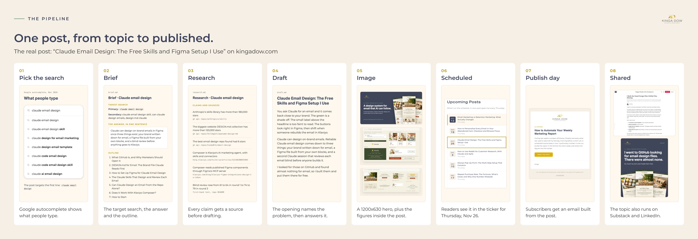

# Part 3: Write the post

**What you get:** a post that answers a real search, in your own voice, with checked facts, a 1200x630 image for link previews and the frontmatter your site needs. It waits in its own folder until you approve it.

**First step (10 minutes):** install the skill and give Claude your `BLOG.md`.

Every account and tool this part uses is in [What you need](../README.md#what-you-need) in the README.

## 1. Install the skill

Open your site's folder in Claude Code (on the starter path, `my-blog`), in a new session. A skill in a site's `.claude/skills` folder only loads in a session opened on that folder. Then ask Claude:

> Copy skills/blog-pipeline from the blog-md kit at [where you saved the kit] into my site's .claude/skills folder.

That puts the skill in a folder called `.claude/skills/blog-pipeline` inside your site's folder, for this site only. Folders whose names start with a dot are hidden in Finder and File Explorer, so you may not see it. Claude can.

To use the skill in every project, copy it to `~/.claude/skills/` instead. `~` means your home folder (on a Mac, the one with your name).

If you already have a skill called `blog-pipeline`, back it up first: copying overwrites it.

## 2. Fill in BLOG.md

Copy [`BLOG.md`](../BLOG.md) to the root of your site's folder (the top folder that holds your site's files; in the starter, next to `package.json`) and fill it in. It holds who you write for, what you want readers to do, how you sound, the words you never use, your categories, your publish day and your SEO and image rules. The skill reads it before every stage, so your rules apply to every post.

[The kingadow.com BLOG.md](../examples/kingadow-com/BLOG.md) shows a filled-in version.

If you'd rather start from what you've already written, ask Claude:

> Read 4 of my existing posts and draft my BLOG.md from them. Ask me about anything you can't tell from the posts.

## 3. Write a post, one stage at a time

Each stage writes one file into the post's folder, `posts/<date>-<slug>/`. You can stop after any stage and pick it up later.

**Your first post:** ask *"Use the blog-pipeline skill to plan my first post."* That runs stage 1, shows you a shortlist of ideas, and after you pick one runs stage 2, the brief. Then carry on with stage 3.

| Stage | Ask Claude | You get |
|---|---|---|
| 1. Ideas | *"Use the blog-pipeline skill to find topic ideas."* New site with no Search Console data? It starts from the questions your clients ask (BLOG.md section 4). | `posts/_ideas/topic-ideas.md`, each idea with its search, its evidence and the existing post it would compete with |
| 2. Brief | *"Write the brief for the topic 'how to price a brand audit'."* | `brief.md`: the target search, the one-sentence answer, titles, outline and links |
| 3. Research | *"Do the research for this brief."* | `research.md`: every claim with its source |
| 4. Draft | *"Draft the post."* | `draft.md` in your voice, answer first, headings phrased as searches |
| 5. Visuals | *"Make the featured image."* | an SVG hero and its 1200x630 PNG, plus `visuals.md` |
| 6. Publish | *"Publish it for my next publish day."* | the published file, `src/content/blog/<slug>.md`, with `draft: true`, ready for your review |

**Approving the post.** After stage 6 the post exists twice. `posts/<folder>/draft.md` is the draft Claude handed over. `src/content/blog/<slug>.md` is the published file the site builds from. You can approve any time after stage 6, once you've read the post, in the same session or later: set `draft: false` in the published file, or tell Claude: *"I approve it. Set draft to false."* Leave it at `draft: true` while anything is still to do before the date, such as a page the post links to that doesn't exist yet or a figure you haven't confirmed: once it says `false`, the weekly build publishes it on its date with nobody checking. After stage 6, make edits in the published file only; Claude lists them in the post folder's `publish.md`. With the [starter site](../starter/README.md), the post appears on its date and the upcoming posts list shows it until then.

[Part 2](2-decide-what-to-write.md) explains stage 1 step by step, if you'd rather pick topics by hand.

## 4. Refresh before you write new

A post Google already shows, with views and no clicks, usually needs a better title, a clearer answer near the top or a missing section. Ask:

> Use the blog-pipeline skill to refresh my post about email welcome series. Search Console shows it for "welcome email examples" with no clicks.

## See it on a real post

[`examples/kingadow-com/posts/2026-11-26-claude-email-design`](../examples/kingadow-com/posts/2026-11-26-claude-email-design) has the brief, research, image plan and images for one kingadow.com post. Its brief uses an earlier layout; the folder's README maps it to the template.

## Done when

- [ ] The skill is installed and your BLOG.md is filled in
- [ ] Your first post has a folder with a brief, research and a draft
- [ ] You've read the draft and approved it
