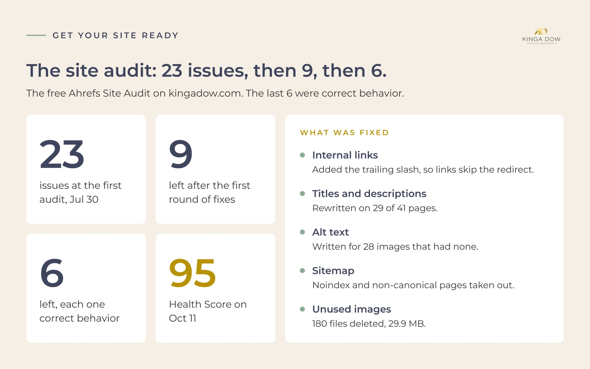
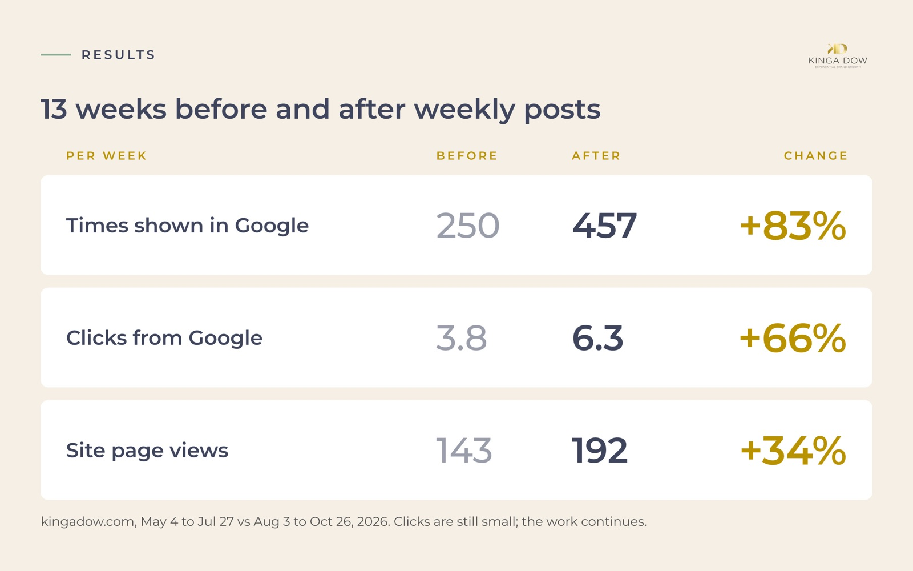
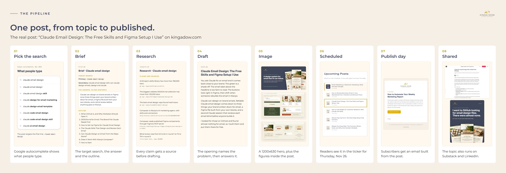

# Worked example: kingadow.com

**What you get here:** the system in this repo running on a real site, with the real before and
after. Read it to see what each part looks like in practice and which step to copy first.

**See it live:** [kingadow.com/blog](https://kingadow.com/blog) shows the published posts and the
Upcoming Posts list.

---

## What the site is

kingadow.com is the site of Kinga Dow, a retention marketing consultancy for e-commerce brands. It
runs on Astro and is hosted on Netlify. The blog shares what Kinga does for clients: email strategy,
Klaviyo, customer retention and working with Claude.

One post has gone live every Thursday since 2026-07-30. Each one is written with Claude using the
method in this repo: [pick the topic](../../docs/2-decide-what-to-write.md), write the post from a
brief and research, publish it on its date.

## The cleanup

Before the first weekly post, the site was cleaned up with the free Ahrefs Site Audit and Claude.
The steps are in [Part 1](../../docs/1-get-your-site-ready.md).

On 2026-07-30 the audit found 23 issues. After the first round of fixes it found 9, then 6. The
last 6 were correct behavior: redirects that exist on purpose, decorative images with empty alt
text, and pages with 1 inbound link. On 2026-10-11 the Health Score was 95.

| What Ahrefs found | What it meant | The fix |
|---|---|---|
| Internal links without the trailing slash | Each link went through a 301 redirect, so 24 pages looked orphaned | Every internal link changed to the exact canonical address |
| 29 of 41 pages with a title or description problem | Titles cut off in Google, descriptions missing or out of range | A shorter title suffix and a written title and description per page |
| 28 images missing alt text | Most were one decorative icon repeated in buttons | Decorative images marked as decorative, meaningful ones described |
| Noindex and non-canonical pages in the sitemap | The sitemap asked Google to index pages that should stay out | Those pages excluded in the sitemap settings |
| 180 of 254 images unused (29.9 MB) | Files left over from earlier versions of the site | Unused files deleted after a check, heavy ones compressed |
| A broken image on the About page | The page pointed at a file that was never uploaded | Pointed at an existing photo that matches the alt text |
| 4 lead magnets with no links in | Visitors and Google had no way to reach them | A tools row added to the footer |

## The weekly rhythm

**Thursday: the post goes live.** Posts are written ahead and carry their publish date. A scheduled
build runs on Thursday morning. Posts dated today or earlier appear, future posts stay hidden, and
the Upcoming Posts list on the blog updates. Subscribers get an email built from the new post the
same day. [Part 4](../../docs/4-automate.md) shows how to set this up.

**Friday: the SEO check.** Claude pulls the week's Search Console and Google Analytics data, checks
that every post is indexed, and makes up to 3 changes by fixed rules: links into new posts that have
few, better titles for searches that show the site and get no clicks, short answers for searches
the site almost ranks for. Each change is logged with a date 6 weeks out to judge it. This routine
becomes Part 5 in a later version of the repo.

The keyword work from [Part 2](../../docs/2-decide-what-to-write.md) feeds both days. Example: "klaviyo
mcp" (210 searches a month, difficulty 25) was split across 3 posts. On 2026-10-21 one post was
retitled to own it, and the other 2 now link to it.

## The results

13 weeks before weekly posts began compared with the 13 weeks after, per week, for the whole of kingadow.com:

| | May 4 to Jul 27 | Aug 3 to Oct 26 | Change |
|---|---|---|---|
| Times shown in Google, per week | 250 | 457 | +83% |
| Clicks from Google, per week | 3.8 | 6.3 | +66% |
| Site page views, per week | 143 | 192 | +34% |

The blog posts on their own went from about 115 to 370 times shown in Google a week, roughly 3 times as often.

An honest note: Google shows the blog more often, and clicks are still small, about 6 a week. More
views in search have not yet turned into many more visits. Growth like this also comes from simply
having more posts, so it cannot all be credited to one change. The work is ongoing, and the weekly
check judges each change after 6 weeks.

## What to copy first

1. **Connect Search Console and run the free Ahrefs Site Audit.** Fixing links, titles and
   descriptions on pages you already have came before any growth in the numbers here. Start with
   [Part 1](../../docs/1-get-your-site-ready.md).
2. **Make every post indexable and check it is indexed.** A post Google has not indexed cannot be
   found.
3. **Give each post one main search term.** Check your existing posts for terms 2 or more of them
   share, and pick one owner. See [Part 2](../../docs/2-decide-what-to-write.md).
4. **Then publish on a fixed day.** One post a week, on the same day, is a pace you can keep.

## One post, from topic to published

[`posts/2026-11-26-claude-email-design`](posts/2026-11-26-claude-email-design) is the working folder
for one real post: its brief, its research, the start of its draft, its image plan and its images.
Follow it to see each stage of [Part 3](../../docs/3-write-the-post.md) on a live post.
